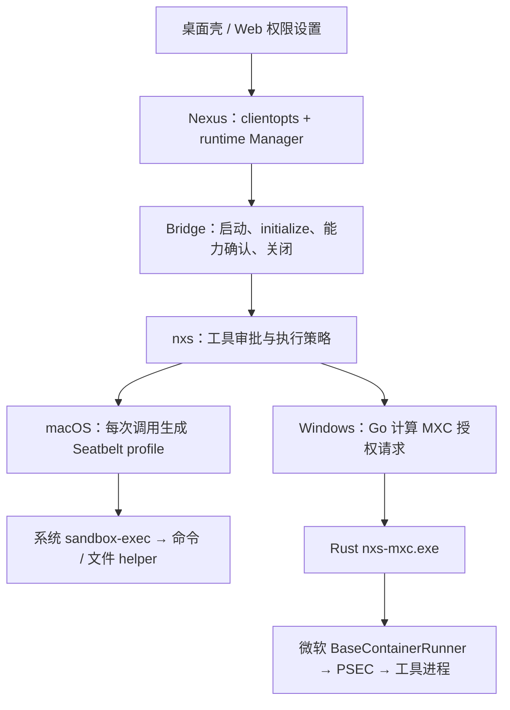

# macOS 与 Windows 桌面沙箱：实现导读

本文面向维护者，解释当前代码如何从宿主配置走到操作系统执行边界，并给出源码阅读入口。它是实现导读，不新增产品合同；行为约束以 [桌面沙箱规范](../specs/desktop-sandbox-spec.md) 为唯一来源，测试要求见 [原生验收清单](../testing/desktop-sandbox-acceptance.md)。本文不构成发布验收结论。

源码基准：Nexus `64d03cf43975a3f94bf163c2689f17ec9a9168f8`；SDK `fed1bf3c01e949a7964c9a1bd60568c0a0ceb2c5`，与当前 Windows 门禁 pin 相同；Bridge 按 Nexus `go.mod` 的 `v0.1.34-0.20260928040950-c994b197e010` 阅读，不以相邻 Bridge 工作区的 HEAD 代替。SDK 与 Bridge 的下列链接固定到这些版本；实际安装包中的二进制仍须单独确认。

## 1. 三层职责与两条执行链

桌面壳负责后端进程的拥有和退出，Nexus Go 宿主负责会话授权与准入，nxs SDK 将具体工具调用转换为本机隔离策略。模型工具的文件/网络边界与进程生命周期是两个不同问题：一个进程被 Job 管理，不代表它的文件访问已受限；一个命令受 Seatbelt 约束，也不代表所有脱离后代都能被宿主回收。

这里的隔离主体是受支持的命令、文件 helper 和对应能力域，不是把整个 Nexus App、nxs 全部 IO、所有 IPC 或外部服务放进一个沙箱。Claude 另有单独路径，见第 6 节。

## 2. 共用的宿主入口

### 从设置到 runtime 准入

先读 [`desktop_sandbox.go`](../../internal/runtime/clientopts/desktop_sandbox.go)，再读 [`sandbox_admission.go`](../../internal/runtime/sandbox_admission.go)。前者生成策略，后者在连接后检查 runtime 是否逐项确认要求。

`applyDesktopSandboxForPlatform` 读取桌面模式、宿主提供的沙箱偏好、runtime 类型及权限模式。它先删除任务环境里的内部策略标记，再由宿主决定是否设置；模型不能通过自己的环境变量伪造或取消这项要求。DM、Room 和后台记忆维护复用这条 options 装配路径。

对受限 nxs，options 包含 `Enabled`、`FailIfUnavailable`、严格 MCP 配置，以及命令、文件、搜索、媒体、Notebook、Skill、上下文、项目、托管策略、设置读写和 MCP 各域的必需能力。能力清单集中在 `nxsSandboxRequirements`，不要在业务调用方再维护一套列表。连接成功后，`validateDesktopSandboxConnection` 逐项检查 `session.Supports`；少一项就拒绝使用该会话。

这有两层作用：防止旧 runtime 忽略宿主字段；防止手工组装 options 的调用方漏掉必要约束。它不证明本机已执行正确的 OS 策略，实际访问结果仍由原生测试证明。

### 宿主私有路径与资源投影

[`desktop_host_paths.go`](../../internal/runtime/clientopts/desktop_host_paths.go) 从宿主真实 app root 和 home 生成保护，不采信任务环境提供的状态根。代码保留原始路径及解析后的别名，保护私有 app 树、Control 数据和 sidecar 身份记录；宿主凭据目录进入禁止读取集合。`skills-public` 在私有 app 树之外，供受限工具读取，并列入禁止写入集合。

工作区和用户挂载目录成为写授权，Skill 目录成为读资源；保护范围随后由 SDK 与具体平台后端实施。`confinedfs` 则用于宿主代 runtime 创建或清理目录，防止宿主自己的文件操作被链接重定向。它与工具进程的 OS 沙箱各守一个边界。

## 3. macOS：按调用生成 Seatbelt 策略

### 命令执行

SDK 的 [`seatbelt.go`][sdk-seatbelt] 将每次执行转换为以下步骤：

1. 使用固定的 `/usr/bin/sandbox-exec`，避免任务 PATH 替换安全后端。
2. 按当前调用的工作目录、最终环境、读写授权、禁止项和网络配置生成临时 `.sb` profile。
3. 以 `sandbox-exec -f <profile> <executable> ...` 启动目标，结束后移除 profile 并释放本次观察资源。

profile 从 `(deny default)` 开始，再开放进程执行、必要系统服务、文件读取和受控写入。这里不能将“默认 deny”解释为“工作区外全不可读”：文件策略本身开放了普通读取，并额外拒绝敏感路径；写入才按工作区、挂载资源和临时目录等授权收窄。禁止读取与禁止写入分别计算，mandatory policy 的拒绝项不能被普通授权重新打开。具体规则生成另见 [`seatbelt_policy.go`][sdk-seatbelt-policy]。

当前 macOS 宿主不再下发持久 scratch 租约或执行回执。nxs 在没有资源合同的路径上使用 `<workspace>/.nexus/sandbox-tmp` 作为工具 `TMPDIR`；工具若忽略它而直接写其他系统临时位置，仍可能被拒绝。临时 profile 文件的存在也不等于宿主维护了一份可恢复的执行状态。

### 文件与其他工具

文件操作通过 SDK [`sandboxfs`][sdk-filesystem] 的受限执行器和文件 worker 落地，而不是只在模型工具入口做字符串路径检查。搜索、媒体、Notebook、Skill、上下文与设置读写各自有能力合同；命令沙箱可用不能替代这些能力的确认。各域覆盖范围直接查阅规范的 [Per-area capabilities](../specs/desktop-sandbox-spec.md#per-area-capabilities)，不从某个 helper 的成功推导整个 SDK IO 都受限。

Seatbelt deny 事件由共享 `log stream` 观察器收集，以每次调用独立的日志标记关联回工具调用；命令结束后保留短暂尾事件窗口。日志是违规观察机制，实际拒绝由内核实施，不能用“没有日志”证明访问未发生或边界有效。

### macOS 进程拥有与退出

这部分与 Seatbelt 分开阅读：

- 原生壳通过 [`SidecarProcessIdentity.swift`](../../desktop/macos/Sources/NexusDesktop/Sidecar/SidecarProcessIdentity.swift) 与 [`SidecarOrphanReaper.swift`](../../desktop/macos/Sources/NexusDesktop/Sidecar/SidecarOrphanReaper.swift) 保存并校验 boot session、audit token、PID 和可执行文件身份，以 `proc_signal_with_audittoken` 定向终止，拒绝退回裸 PID 终止。
- Go 宿主通过 [`desktopinstance`](../../internal/infra/desktopinstance/lock_darwin.go) 持有 `app/sidecar.lock` 内核锁，防止同协议的第二个 sidecar 同时启动。
- 固定版本 Bridge 的 [`process_session_unix.go`][bridge-unix] 为 runtime 建立 Unix session，并有界枚举、回收仍属于该 session 的后代。它不覆盖通过 `setsid` 脱离的新 session，不能写成 Windows 式 kill-on-close Job 保证。

因此，“无状态沙箱”只表示不再保存沙箱启动/策略/scratch 恢复状态，不表示没有 sidecar 身份记录、实例锁或常规会话清理。

## 4. Windows：Go 授权、Rust 包装、微软 PSEC 执行

### 启动与能力探测

Windows 受限路径使用 nxs。宿主先拒绝管理员提权令牌，准备资源；SDK 与 Rust helper 也检查提权状态。默认从 nxs 同目录查找 `nxs-mxc.exe`，测试覆盖入口 `NEXUS_MXC_LAUNCHER` 只读取宿主环境，任务环境不能替换 helper。

[`windows_mxc_windows.go`][sdk-mxc] 与 [`native.rs`][sdk-native] 分别负责 Go 入口及原生包装。helper 的 `--probe` 检查 PSEC 接口与合同，尝试最小环境创建/关闭，并返回协议版本和固定微软 revision；Go 校验兼容性。实际执行时，官方 runner 还要验证该次具体策略。探测成功与实际目录、网络、嵌套 Job 的可用性不是同一结论。

当前 helper 调用固定版本微软 `mxc-sdk` 的 `BaseContainerRunner`；固定 revision 位于 SDK [`Cargo.toml`][sdk-cargo]。正常执行链已经不是旧 `wxc-exec.exe + mxc_ffi.dll` 集成，也不是自研 Go PSEC 编码器。没有 AppContainer、SBOX 或宽松执行后端作为失败回退。

### 文件策略映射与 scratch

[`windows_mxc_policy.go`][sdk-mxc-policy] 将授权转换为读写、只读和拒绝路径集合，统一路径大小写与分隔符，处理包含关系和冲突。当前只禁写路径形成只读 carveout，仍能读取；显式禁读路径进入拒绝集合。普通本地卷与系统读取按策略开放，写入仍受授权范围限制。因此旧交接说明中的“禁写一律读写同拒”不能继续作为当前实现描述。

宿主资源由 [`desktop_windows_resources.go`](../../internal/runtime/clientopts/desktop_windows_resources.go) 准备：

- canonical workspace 的哈希确定 `users/<owner>/runtime/tmp/sandbox/<workspace-hash>`，scratch 与 workspace 双向检查不重叠。
- `confinedfs` 拒绝链接穿越，并创建 scratch 和合成 profile 所需的 `AppData/Local`、`AppData/Roaming`。
- 资源是 workspace 共享边界，不是每个调用独占的临时租约，也没有持久化沙箱恢复回执。
- Windows 禁止目标存在缺失中间目录时，宿主将保护上移到第一个缺失目录，避免为满足 PSEC 而创建真实凭据目录或丢弃保护。

PSEC 进入环境时会重写 TEMP/TMP。Rust helper 在同一隔离环境内启动 bootstrap，先将 TEMP/TMP 恢复到已授权 scratch，再启动目标命令；此过程不新增写授权。当前受限 Windows 暴露原生 PowerShell，Git Bash 的 MSYS 对象命名空间不在这条支持路径内。

### runtime 级只读 worker

Windows 使用 [`ReadPool`][sdk-readpool] 复用一个受限读取 worker，减少初始化设置、项目发现及后续上下文读取反复创建容器的开销。池属于单个 runtime，没有跨 Agent 的全局池，也不缓存文件内容。

复用条件包含完整策略、工作目录、helper 身份和显式禁读根的身份。请求前后重新检查禁读根；策略变化、身份变化、检查失败、请求取消或 runtime 关闭时回收 worker。普通“文件不存在”错误不必摧毁整个 runtime。该检查不是原子文件系统快照，也不证明能抵御所有 ABA 替换。

只读 worker 入口仅接受读取和元数据操作；写入、命令及一次性文件授权仍走独立执行生命周期。SDK recorder 的记录写入使用单独受限执行器，将写根收窄到当前项目 transcript 目录，不扩大模型工具的授权。协议与 bootstrap 细节见 [SDK Windows 实现说明][sdk-windows-doc]。

### 三层进程拥有

| 层级 | 代码机制 | 需要区分的边界 |
| --- | --- | --- |
| Windows 桌面壳 → Go 后端 | [`SidecarProcessLifetime.cs`](../../desktop/windows/Nexus.Desktop/Sidecar/SidecarProcessLifetime.cs) 用 `PROC_THREAD_ATTRIBUTE_JOB_LIST` 在创建时原子加入 kill-on-close Job，显式继承三条标准流，挂起创建后恢复 | 正常退出先关闭 stdin 等待后端清理，再终止 Job 并等待活动进程归零；这是后端进程拥有 |
| Go/Bridge → nxs 与探测进程 | 固定 Bridge [`process_session_windows.go`][bridge-windows] 挂起创建、加入 Job、恢复初始线程 | 创建与加入 Job 是两个操作，存在中间崩溃窗口；不能套用桌面壳的原子保证 |
| Rust helper → 工具进程 | helper 先将自己放入外层 kill-on-close Job，再调用官方 runner；runner 管理内层 Job 与 PSEC | 嵌套 Job、取消和前台退出后的后代清理仍要原生验证 |

Windows 壳的恢复记录用 PID、创建时间、可执行路径和状态根识别原后端，不按进程名扫杀。关闭失败保留记录和诊断；“句柄已经关闭”不能替代“进程已经退出”。

[`CleanupWindowsScratch`](../../internal/infra/desktopinstance/scratch_cleanup.go) 只在桌面壳已清理旧后端、尚未启动 runtime 时清理 64 位十六进制命名的 workspace scratch 子目录；运行中不清理共享 scratch。独立后端没有桌面父进程拥有关系时不执行这项启动清理。

## 5. 网络与审批如何接到执行层

[`desktop_network_admission.go`](../../internal/runtime/clientopts/desktop_network_admission.go) 将宿主精确域名授权投影成 SDK 网络配置。Nexus 明确传入空 `AllowedDomains`，其含义是初始不放行普通工具的未知网络目标；不能与 SDK 通用接口中“没有配置 allowlist”混为一谈。

执行后端约束可连接的网络路径，代理执行域名准入。未知连接进入独立 `sandbox_network` 审批，批准只恢复那条待连接请求，不重跑整个命令，也不直接开放任意 TCP。审批等待可能耗尽客户端自身的超时，批准不代表 HTTP 请求已成功。

文件越界写入与 macOS 显式命令逃逸走 `sandbox_escape` 边界；一次性文件授权只覆盖被审核 helper 的操作及其原子暂存，不变成持久目录白名单。权限 epoch 变化使旧请求失效。实现与约束详见规范的 [Network approval](../specs/desktop-sandbox-spec.md#network-approval) 和 [Sandbox escape](../specs/desktop-sandbox-spec.md#sandbox-escape)。

MCP 有独立的网络、helper、stdio 能力要求和严格配置。MCP 端点能连接不等于它的地址已授权给普通命令；宿主/第三方服务自身能执行什么也不能由本地命令沙箱代为保证。

## 6. 两端不能合并描述的差异

| 维度 | macOS | Windows |
| --- | --- | --- |
| nxs 执行后端 | 每次调用的 Seatbelt profile + 系统 sandbox-exec | Go 策略 → Rust helper → 官方 BaseContainerRunner/PSEC |
| 宿主资源合同 | 不要求显式 scratch 合同 | 受限 nxs 要求与 workspace 分离的 scratch |
| 显式命令逃逸 | nxs 可进入独立一次性审批 | 受限 nxs 设置 `AllowUnsandboxedCommands=false` |
| nxs Full Access | 保留 nxs 能力握手与生命周期，通过 SDK 模式放宽策略 | options 提前返回，不投影沙箱策略或网络准入 |
| Claude 受限模式 | Bridge 生成并验证原生 sandbox settings；独立于 nxs 能力 | 拒绝启动 |
| Claude Full Access | 不安装 Claude 原生沙箱合同 | 不安装受限合同 |
| 后代清理机制 | Bridge Unix session 回收；不覆盖另建 session 的脱离后代 | 多层 Job 拥有；各层原子性不同 |

Full Access 在两端都不应宣传为有沙箱隔离，也不会获得管理员权限。实时权限跨越 Full Access 边界时，应结合 [`sandbox_policy.go`](../../internal/runtime/sandbox_policy.go)、[`process_policy.go`](../../internal/runtime/process_policy.go) 和 Manager 客户端替换路径阅读：旧 runtime 退出后重新构建 options，不能用热更新权限字段冒充 OS 策略已替换。停止旧进程不会回滚已产生的副作用，更不授权自动重放。

Claude 的 `RequireClaudeNativeSandbox` 路径生成 `enabled=true`、`failIfUnavailable=true`、`allowUnsandboxedCommands=false`，并由 Bridge 检查 CLI settings 入口。它不是 `--restricted` 删除工具，也不是 Claude 返回了 nxs 的能力确认；CLI 帮助探测不证明有效隔离，实际命令/网络/凭据和清理验收仍需独立完成。

## 7. 维护与验证的阅读顺序

1. 修改授权装配：先看 `clientopts/desktop_sandbox.go`、`desktop_host_paths.go`、`desktop_network_admission.go`，再核对 `sandbox_admission.go` 与过程策略指纹。
2. 修改平台执行：macOS 从 SDK Seatbelt profile 和文件 helper 开始；Windows 从 Go policy、Rust helper、固定微软依赖开始。不要在 Nexus 宿主重新实现底层 runner。
3. 修改退出：分别检查桌面壳、Bridge、SDK 工具进程，不能拿某一层的回收测试覆盖其他层。
4. 验证：先跑对应组件测试，再按 [原生验收清单](../testing/desktop-sandbox-acceptance.md) 执行真实工具、取消、关闭重开和打包验证。测试命令与必测列表保留在该清单和门禁脚本，不在本文复制。

macOS 固定运行时基线入口是 [`check-sandbox-baseline.mjs`](../../scripts/desktop/check-sandbox-baseline.mjs)；Windows 入口是 [`check-windows-sandbox.mjs`](../../scripts/desktop/check-windows-sandbox.mjs)。Windows `--native` 的组件检查与普通交互用户下的实际 MXC enforcement 检查仍有区别，后者由 `NEXUS_ALLOW_LOCAL_NATIVE_EVIDENCE=1` 路径执行。私有 SDK 凭据缺失导致跳过、交叉编译通过、probe 成功或文件签名有效，都不能作为完整隔离验收。

旧交接材料中的持久租约、沙箱启动/策略恢复表、machine-Host/NUL 后端、旧 MXC 可执行文件布局不能继续作为操作指南。当前迁移实现见 [`internal/migration`](../../internal/migration/doc.go)：退役资源的一次性清理属于升级兼容，不是当前沙箱的恢复协议。

[sdk-seatbelt]: https://github.com/nexus-research-lab/nexus-agent-sdk-go/blob/fed1bf3c01e949a7964c9a1bd60568c0a0ceb2c5/internal/tool/builtin/bash/sandboxexec/seatbelt.go
[sdk-seatbelt-policy]: https://github.com/nexus-research-lab/nexus-agent-sdk-go/blob/fed1bf3c01e949a7964c9a1bd60568c0a0ceb2c5/internal/tool/builtin/bash/sandboxexec/seatbelt_policy.go
[sdk-filesystem]: https://github.com/nexus-research-lab/nexus-agent-sdk-go/blob/fed1bf3c01e949a7964c9a1bd60568c0a0ceb2c5/internal/tool/builtin/file/sandboxfs/filesystem.go
[sdk-readpool]: https://github.com/nexus-research-lab/nexus-agent-sdk-go/blob/fed1bf3c01e949a7964c9a1bd60568c0a0ceb2c5/internal/tool/builtin/file/sandboxfs/read_pool.go
[sdk-mxc]: https://github.com/nexus-research-lab/nexus-agent-sdk-go/blob/fed1bf3c01e949a7964c9a1bd60568c0a0ceb2c5/internal/tool/builtin/bash/sandboxexec/windows_mxc_windows.go
[sdk-mxc-policy]: https://github.com/nexus-research-lab/nexus-agent-sdk-go/blob/fed1bf3c01e949a7964c9a1bd60568c0a0ceb2c5/internal/tool/builtin/bash/sandboxexec/windows_mxc_policy.go
[sdk-native]: https://github.com/nexus-research-lab/nexus-agent-sdk-go/blob/fed1bf3c01e949a7964c9a1bd60568c0a0ceb2c5/native/nxs-mxc/src/native.rs
[sdk-cargo]: https://github.com/nexus-research-lab/nexus-agent-sdk-go/blob/fed1bf3c01e949a7964c9a1bd60568c0a0ceb2c5/native/nxs-mxc/Cargo.toml
[sdk-windows-doc]: https://github.com/nexus-research-lab/nexus-agent-sdk-go/blob/fed1bf3c01e949a7964c9a1bd60568c0a0ceb2c5/docs/sdk/windows-mxc.md
[bridge-unix]: https://github.com/nexus-research-lab/nexus-agent-sdk-bridge/blob/c994b197e010/internal/transport/process_session_unix.go
[bridge-windows]: https://github.com/nexus-research-lab/nexus-agent-sdk-bridge/blob/c994b197e010/internal/transport/process_session_windows.go
